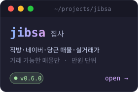
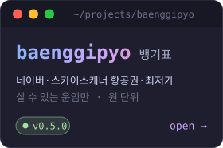

### `$ whoami`


```python
class JungHoo:
    role = "Data Engineer"
    also = "Automation Engineer"  # UiPath RPA → Python

    stack = {
        "data":    ["Airflow", "MySQL", "Hive", "Kafka", "Trino", "ClickHouse"],
        "infra":   ["Docker", "Kubernetes", "CircleCI", "MLflow"],
        "monitor": ["Grafana", "Prometheus"],
        "auto":    ["UiPath", "Slack API", "Flask", "Streamlit", "Puppeteer"],
    }

    def work(self):
        return {
            "pipeline":   "Airflow 로 대규모 배치 설계·운영",
            "recovery":   "체크포인트·재시도로 실패한 단계부터 복구",
            "sdk":        "사내 DB·모니터링·업무 시스템용 Python SDK",
            "automation": "금융·회계·인사 업무 자동화, RPA → Python 전환",
            "ci_cd":      "CircleCI 로 테스트·빌드·배포 자동화, K8s 운영",
        }

    def side(self):
        # 퇴근 후: LLM 에이전트가 셸에서 부르는 조회 CLI
        return ["jibsa", "baenggipyo"]
```

<picture>
  <source media="(prefers-color-scheme: light)" srcset="https://skillicons.dev/icons?i=py%2Cmysql%2Ckafka%2Cdocker%2Ckubernetes%2Cgrafana%2Cprometheus%2Cflask%2Cjs%2Cgit&theme=light" />
  
</picture>

<br/><br/>

### `$ ls ~/projects`

<a href="https://github.com/Rukkakka/jibsa"></a>&nbsp;<a href="https://github.com/Rukkakka/baenggipyo"></a>

<pre>
# jibsa 와 baenggipyo 는 LLM 에이전트가 쓰라고 만든 CLI 입니다
#  - 웹 검색에 걸린 지난 정보 말고, 지금 거래 가능한 것만 가져옵니다
#  - 로그인 없이 볼 수 있는 정보만 쓰고, 사이트별 요청 제한을 지킵니다
#  - 결과는 공통 JSON 으로 돌려주고, 예약·문의는 결과의 url 로 넘깁니다
</pre>

<details open>
<summary><code>$ claude</code> &nbsp;# Claude Code 가 집사로 집을 찾는 모습 (예시 화면)</summary>
<br/>

</details>

<br/>

### `$ ls ~/libs`

<pre>
<a href="https://github.com/Rukkakka/lib"><b>lib/</b></a>   데이터·모니터링·업무 시스템 클라이언트 래퍼 모음

#  - DB: ClickHouse (동기·비동기), Trino
#  - 모니터링: Grafana, Prometheus
#  - 업무·외부: Slack, Jira, Microsoft Graph, Google Drive·Sheets, 공공데이터포털
#  - 연결 설정은 pydantic 모델로 먼저 검증합니다
#  - 클라이언트는 처음 쓸 때 만들고, with 블록이 끝나면 알아서 닫습니다
#  - HTTP API 는 5xx·429·타임아웃이면 자동으로 다시 시도하고, async 버전도 있습니다
</pre>

<br/>

### `$ git log --stat`

<picture>
  <source media="(prefers-color-scheme: dark)" srcset="https://streak-stats.demolab.com/?user=Rukkakka&theme=tokyonight&hide_border=true&background=00000000&ring=B13DC8&fire=B13DC8&currStreakLabel=B13DC8" />
  
</picture>

### `$ contact`

<pre>
velog   → <a href="https://velog.io/@lcs3947">velog.io/@lcs3947</a>
mail    → <a href="mailto:lcs3947@naver.com">lcs3947@naver.com</a>
</pre>


